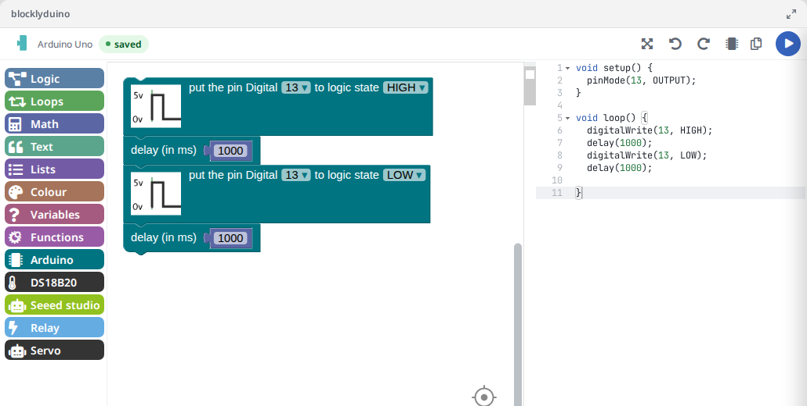

# Edrys BlocklyDuino Module

Program Arduino boards with blocks in an Edrys class. The module is
[BlocklyDuino v2](https://github.com/BlocklyDuino/BlocklyDuino) (Blockly blocks, with the generated Arduino code
shown next to them) with an Edrys layer on top: everyone in a room edits **one shared program**, and the run button
sends the generated code to the station, for example to a terminal module that compiles and uploads it.



## Usage

Add the module to your class with this URL:

```
https://edrys-labs.github.io/module-blockly-duino-v2/index.html
```

## Configuration

Open the module in the class settings. All fields are optional and in the general tab (`config`):

| Field | What it does |
|-------|--------------|
| `code` | The program a room starts with, as Blockly XML. Without it, rooms start empty. |
| `board` | The board a room starts with. It sets the pins the blocks offer. Default: `arduino_uno`. |
| `runCommand` | The message subject the run button sends the code with. Default: `execute`. |

To get the XML for `code`, build the program in the module and use **Menu > Save to BlocklyDuino file**, or
start from one of the [examples](examples/). In YAML, use a literal block (`|`) for the XML:

``` yaml
config:
  board: arduino_uno
  runCommand: execute
  code: |
    <xml xmlns="https://developers.google.com/blockly/xml">
      <block type="board_base_inout_buildin_led" x="18" y="17">
        <field name="STAT">HIGH</field>
      </block>
    </xml>
```

Boards (`board`):

| Id | Board |
|----|-------|
| `arduino_uno` | Arduino Uno |
| `arduino_nano` | Arduino Nano |
| `arduino_mini` | Arduino Mini |
| `arduino_pro8` | Arduino Pro Mini 3.3 V |
| `arduino_pro16` | Arduino Pro Mini 5 V |
| `arduino_mega` | Arduino Mega |
| `arduino_leonardo` | Arduino Leonardo |
| `arduino_micro` | Arduino Micro |
| `arduino_yun` | Arduino Yún |
| `lilypad` | LilyPad |

Problems with the configuration (an unknown board, a start program that can't be loaded) are shown in a red
banner at the bottom of the module, and the status in the top bar shows "error".

## In class

* __One program per room.__ All peers in a room see and edit the same program. A change is sent to the others
  2 seconds after the last edit; the status in the top bar shows "sending…" until then and "saved" after. If
  two people edit within the same 2 seconds, the later change wins.
* __Late joiners and reloads__ get the room's current program. Changing `code` in the settings starts every room
  over with the new program.
* __Board.__ The top bar shows the room's board. Teachers and stations can change it with the board button; the
  change applies to the whole room. Students don't get the button (this only hides it, it is not a permission).
* __Run.__ The run button (▶) sends the generated Arduino code as a message with the subject `runCommand`. A
  module on the station has to listen for that subject, for example
  [pyxtermjs](https://github.com/edrys-labs/module-pyxtermjs) with a command that compiles and uploads the code.
* __Reset__ (in the menu) brings the room back to the configured `code` and `board`, for everyone.
* __Setup__ (in the menu) is personal and stays in the browser: language (English, German, French, Spanish,
  Catalan, Japanese, Arabic), block theme (incl. colour-blind and high-contrast themes), block renderer, font size,
  accessibility mode and key mappings. Users can mix languages in one room; the program is the same.

### Keyboard navigation

**Ctrl + Shift + K** turns keyboard navigation on and off. Then:

| Key | Action |
|-----|--------|
| W | previous block, field or input on the same level |
| S | next block, field or input on the same level |
| A | up one level (field → block → stack → workspace) |
| D | down one level (workspace → stack → block → field) |
| T | open the toolbox (move with W/A/S/D, insert a block with Enter) |
| Enter | mark the current location |
| I | connect the current location to the marked one |
| X | disconnect the block at the cursor from its parent |
| E or Esc | close the toolbox or a field editor |
| Shift + W/A/S/D | move the workspace cursor up/left/down/right |

The keys can be changed in Setup with "open key mappings" (kept for the browser tab). Setup also offers three
cursors: the default cursor (previous, next, in, out), the basic cursor (all locations in order) and the line
cursor. See Blockly's [keyboard navigation guide](https://developers.google.com/blockly/guides/configure/web/keyboard-nav).

## Development

The Edrys part is in [js/edrys.js](js/edrys.js) (shared program and board, status, run, reset),
[js/settings.js](js/settings.js) (personal Setup choices) and [css/edrys.css](css/edrys.css); the rest is
BlocklyDuino v2 and Blockly 3 (September 2020) as upstream left them, trimmed to what works in a browser.
The shared state is kept in the room, under these keys:

| Key | Content |
|-----|---------|
| `blocklyXml` | the room's program (Blockly XML) |
| `blocklySeed` | the `code` from the settings the program was started from |
| `blocklyBoard` | the room's board |
| `blocklyBoardSeed` | the `board` from the settings the room was started with |

Personal settings are stored in `localStorage` under `module-blockly-duino-v2.settings`.

End-to-end tests (teacher and student in a real edrys-Lite) are in the edrys-module-tests repository under
`modules/module-blockly-duino-v2`. They run in Chromium, Firefox and WebKit (Safari's engine).

## Credits

* [BlocklyDuino](https://github.com/BlocklyDuino/BlocklyDuino) by Sébastien Canet (v2) and Fred Lin (original),
  inspired by [Blockly@rduino](https://github.com/technologiescollege/Blockly-at-rduino),
  [ardublockly](https://github.com/carlosperate/ardublockly), [Blocklino](https://github.com/fontainejp/blocklino)
  and [STudio4Education](https://github.com/A-S-T-U-C-E/STudio4Education)
* [Blockly](https://developers.google.com/blockly) by Google (Apache 2.0)
* [Ace](https://ace.c9.io/) code editor (BSD)
* [Font Awesome](https://fontawesome.com/) icons (CC BY 4.0, fonts SIL OFL 1.1)

## License

[GPL-3.0](LICENSE) © Sébastien Canet, Fred Lin and edrys-labs

Code from Blockly is licensed under Apache 2.0, code from STudio4Education under BSD 3-Clause.
